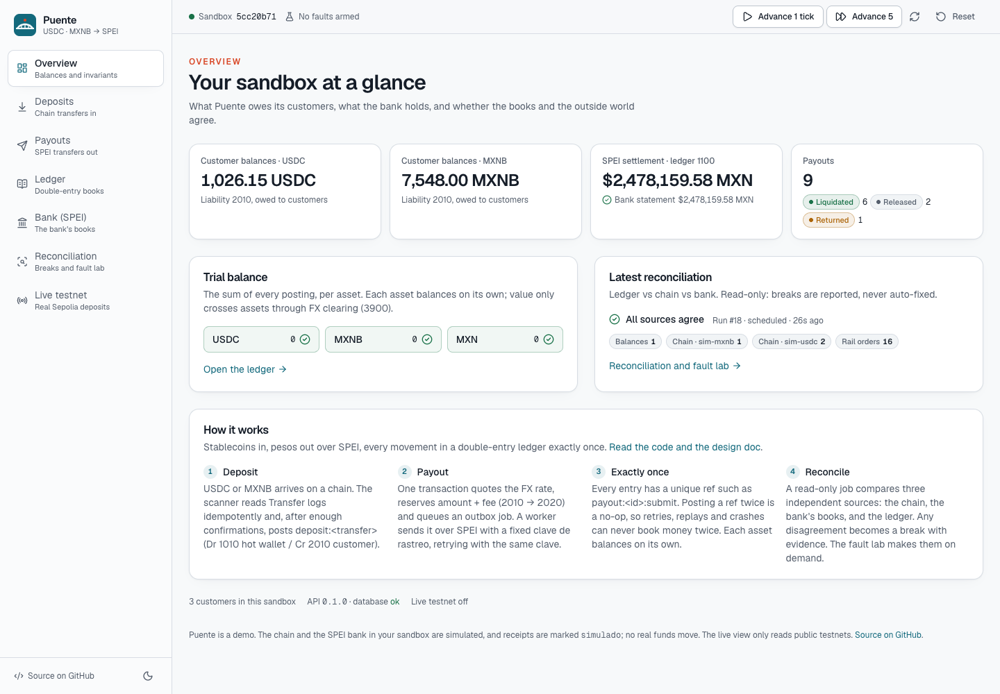
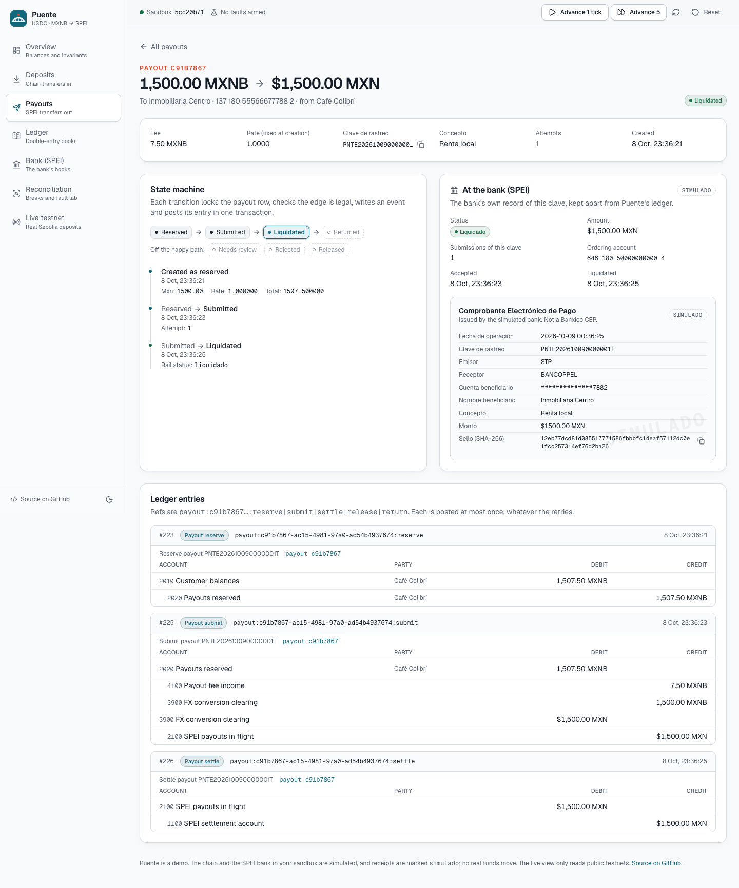
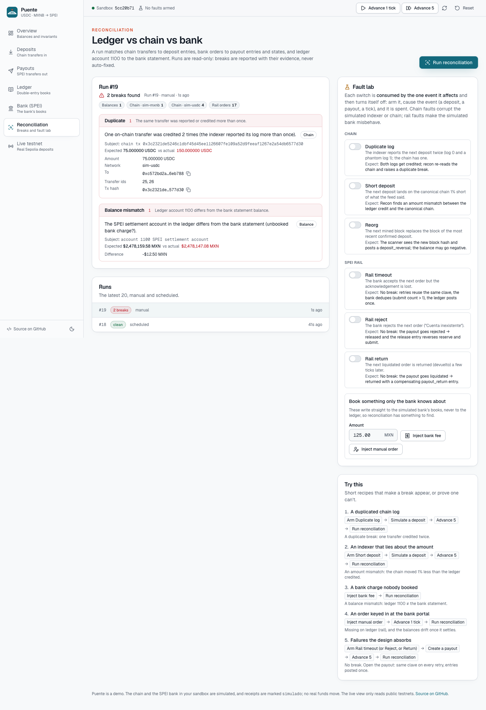

# Puente

**A stablecoin-to-SPEI payout ledger in Go.** Customers hold USDC or MXNB that arrives on a chain.
Puente pays Mexican bank accounts in pesos over SPEI, records every movement in a double-entry
ledger exactly once, and reconciles that ledger against the chain and the bank.

**Live demo:** *(coming soon)*. Each visitor gets their own seeded sandbox. Nothing real moves:
the chain and the SPEI bank are simulated, and the optional live view only reads public testnets.



## Try this

1. **Payouts → New payout.** Pay 100 USDC to a CLABE and watch the quote: a 50 bps fee, a fixed
   rate, and the exact pesos with the sub-centavo dust shown. Press **Send twice**: the second
   request carries the same `Idempotency-Key` and comes back byte for byte with
   `Idempotent-Replay: true`. The balance moves once.
2. **Advance 1 tick** twice, then open the payout. You'll see the state machine
   (reserved → submitted → liquidated), the ledger entries each step posted, and the bank's order
   with its CEP receipt.
3. **Reconciliation → Fault lab.** Arm *Duplicate log*, simulate a deposit, advance 5 and run
   reconciliation. The indexer reported one transfer twice, both were credited, and recon finds
   the duplicate by re-reading the canonical chain. Then try *Short deposit*, *Reorg*, a bank fee
   or a manual order keyed in at the bank's portal.
4. **Arm Rail timeout** (or reject, or return) and create a payout. No break appears. The bank
   lost the ack, the worker retried with the same clave de rastreo, the bank deduplicated it, and
   the ledger posted once.



## What's inside

- **Multi-asset double-entry ledger.** USDC, MXNB and MXN in integer minor units. Every entry
  balances per asset, checked in Go and by a deferred Postgres constraint trigger. A per-customer
  sub-ledger covers balances and reservations.
- **Exactly-once posting.** Entries are keyed by business event (`payout:<id>:submit`,
  `deposit:<transfer>:<gen>`), so any retry is a no-op and a conflicting retry is an error.
- **Payout state machine.** It runs on a transactional outbox (`FOR UPDATE SKIP LOCKED`). Retries
  reuse the same clave de rastreo; timeouts back off exponentially and end in `needs_review`.
  Devoluciones are reversed with compensating entries, never deletes.
- **Chain ingestion.** A pluggable `Source` port:
  - a simulated chain per sandbox, with fault injection;
  - go-ethereum for USDC on Base Sepolia and MXNB on Arbitrum Sepolia (Bitso's peso stablecoin).
  - The scanner pages ≤200 blocks (the public RPC limit), waits for confirmations, and detects
    reorgs, reversing the credit and re-crediting the transfer if it is re-included.
- **Simulated SPEI participant.** It keeps its own books: orders unique on the clave, plus a
  settlement-account statement. It validates CLABE check digits and issues CEP-like receipts
  marked *simulado*.
- **Reconciliation.** One REPEATABLE READ snapshot compares the ledger with the chain, the rail and
  the bank statement. It reports six break kinds with evidence and never auto-fixes.
- **HTTP API.** Per-visitor sandboxes, idempotency keys and a stable error envelope. Plus a CLI
  and a React SPA.

The design review, with the ledger chart, entry catalog, state machine, failure-mode table and
alternatives considered, is in **[docs/architecture.md](docs/architecture.md)**.



## Architecture

```
            ┌──────────── engine (per-sandbox cycle) ─────────────┐
 chain ──►  │ chain.Scan ──► deposit.Credit ──► ledger.Post       │
 (sim/evm)  │ payout.Create ─► outbox ─► worker ─► spei.Submit ───┼──► SPEI (sim)
            │                   └── SyncRail ◄── rail.Advance     │
            │ recon.Run: ledger ⇄ chain, ledger ⇄ rail, balances  │
            └─────────────────────────────────────────────────────┘
      api (HTTP) · cmd/puente (CLI) · web (React SPA) · Postgres
```

One Go binary and one Postgres. Workers coordinate through row locks, so it can run as several
replicas without a broker.

## Run it

```bash
docker compose up --build        # http://localhost:8000, seeded per visitor
```

Or for development (Go 1.27, Node 24, Docker for Postgres):

```bash
just install
just dev                         # Postgres on :5435, API on :8000
just web                         # Vite on :5173, proxying /api
```

The CLI:

```bash
puente seed                      # a seeded sandbox; prints its id
puente ledger balance --sandbox <id>
puente recon run --sandbox <id>
puente payout create --sandbox <id> --customer "Ana Torres" --asset USDC --amount 25 \
  --clabe 012180015203300154 --name "Luis Pérez"
```

### Live testnet mode (optional, read-only)

Set `PUENTE_LIVE_WATCH_ADDRESS` plus `PUENTE_LIVE_USDC_RPC` (Base Sepolia) and/or
`PUENTE_LIVE_MXNB_RPC` (Arbitrum Sepolia). The **Live testnet** page then follows real deposits to
that address, credits them after confirmations and reconciles them against the chain. Send it
testnet USDC from [Circle's faucet](https://faucet.circle.com) and watch it land. Sending tokens is
operator-only, through `puente chain send --yes` with `PUENTE_HOT_WALLET_KEY`. The API has no route
to it. See [.env.example](.env.example) for every setting.

## Quality gate

```bash
just ci        # gofmt, go vet, golangci-lint, go test -race, eslint, vitest, vite build
just smoke     # builds the image, starts the stack, drives the whole story over HTTP
```

- **Postgres tests use testcontainers.** No mocks below the HTTP boundary.
- **The EVM adapter is tested against go-ethereum's in-process simulated chain,** including reorgs
  via `Fork`, with a tiny ERC-20 in `contracts/`.
- **Every reconciliation break kind has a scenario test** that starts from a clean world.
- **Concurrency tests:**
  - 10 concurrent payouts against funds for 3;
  - 4 workers on 20 queued payouts;
  - 10 identical idempotent requests.

## Deploy

`render.yaml` deploys one free Render web service from the Docker image. Point `DATABASE_URL` at a
Neon Postgres, using the **direct** connection string, not the `-pooler` host: Puente sets lock and
statement timeouts per connection. Migrations run on start, and every new visitor gets a freshly
seeded sandbox. Sandbox creation is rate-limited per IP.

## Honest limits

- **The SPEI rail is a simulator.** It models statuses, claves, CLABEs and a CEP-like receipt, but
  it is not Banxico-conformant and does not talk to STP or Juno.
- **Live mode reads deposits only.** Live payouts would need a real off-ramp, and Bitso/Juno
  requires KYB.
- **FX rates are configured, not priced.** USDC is 18.4523 MXN by default.
- **Scheduled reconciliation runs inside the web process,** so on a sleeping free instance it only
  runs while someone is using the demo.

## License

MIT
